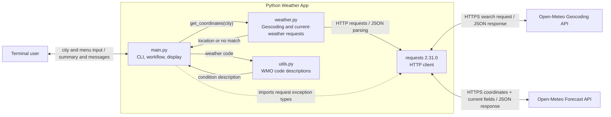
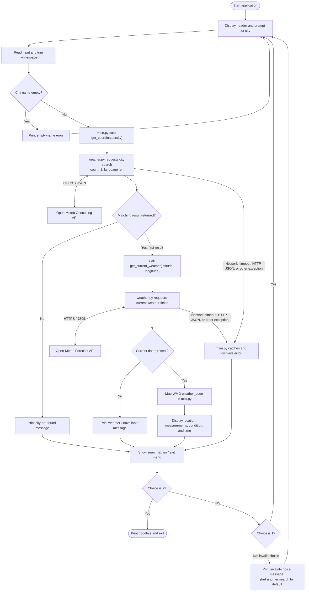
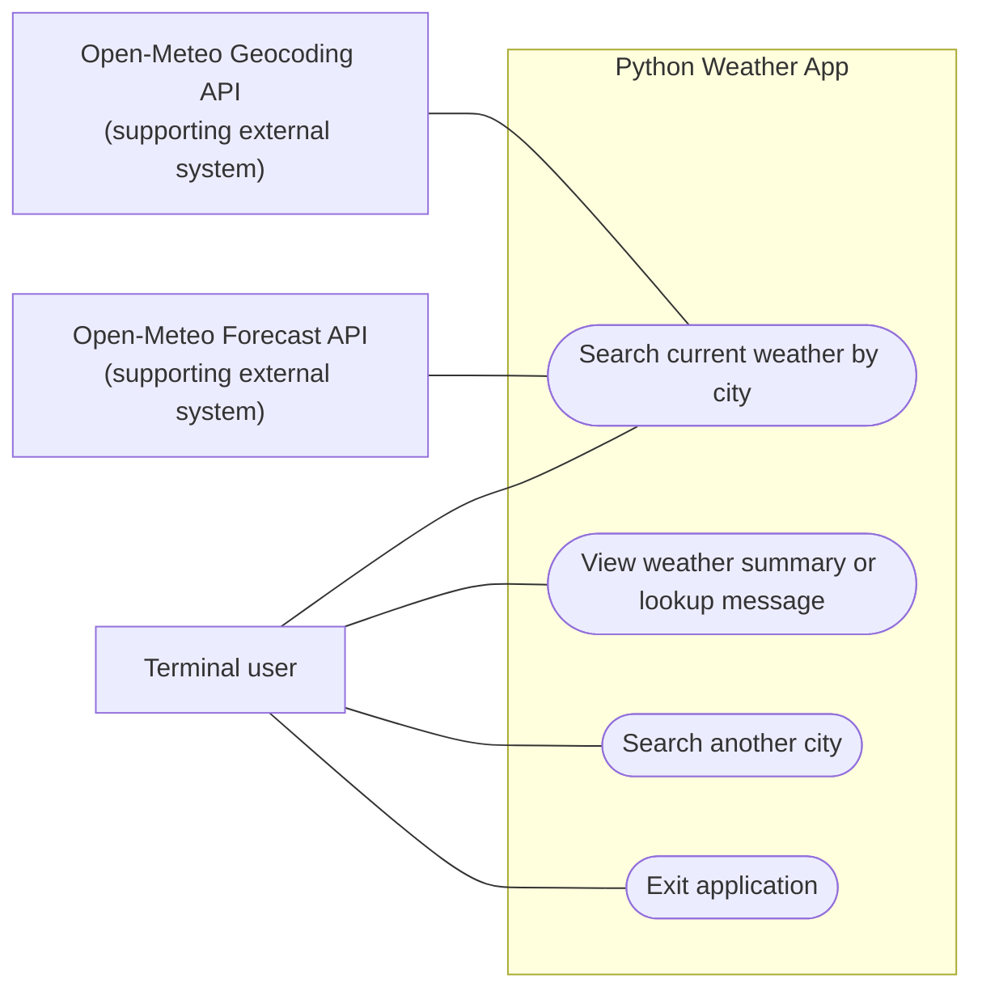
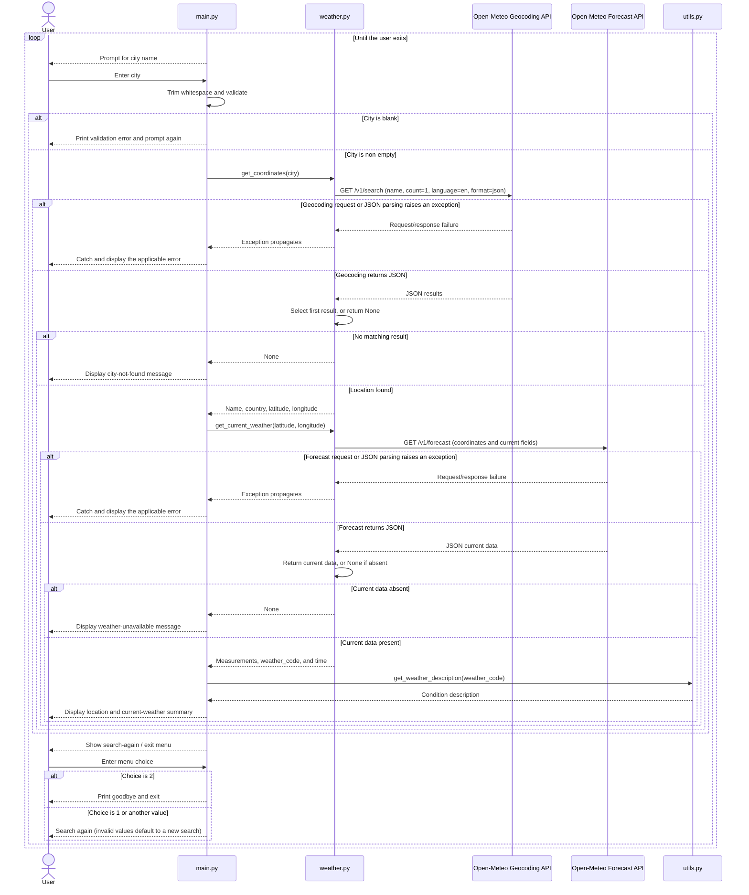
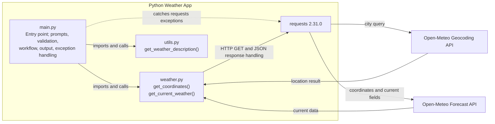

# Design Diagrams

These diagrams describe the implemented Python command-line application. Its only interactive actor is a terminal user. The application has no browser frontend, application server, authentication, or persistent storage; weather information comes from the external Open-Meteo APIs.

## 1. System Architecture Diagram

## 2. Workflow / Process Flow Diagram

Pressing Ctrl+C is also handled by the entry point, which prints an interruption message and exits. No database operations occur; the city and weather responses are used in memory for the current search only.

## 3. Use Case Diagram

The terminal user is the only human actor supported by the code. The two APIs are secondary external systems involved in the search use case; there are no separate user roles or authentication flows.

## 4. Sequence Diagram

## 5. Component Diagram

The code is organized as procedural Python modules rather than classes, so a component diagram best represents its structure and responsibilities.

## 6. ER Diagram

An ER diagram is not applicable. The implementation has no relational database or persistent structured storage. API response data is held in transient Python dictionaries during a search; no entities, primary keys, foreign keys, or stored relationships are defined.